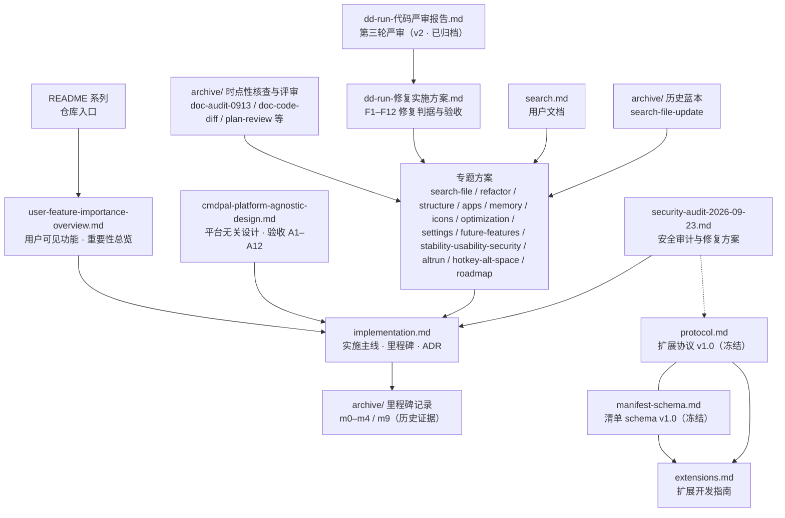

# dd-run 文档索引

> **状态**：生效中 ｜ **版本**：v1.76 ｜ **最后更新**：2026-11-25
> **用途**：全部文档的**唯一导航入口**——按模块分组、标注状态与读者，并定义文档格式规约。
> **关联**：（本文即导航入口——全部文档见 §3 清单并回链本文）

---

## 1. 怎么用这份索引

| 你的目的 | 阅读路径 |
|---|---|
| **写一个扩展** | [`extensions.md`](./extensions.md)（路径）→ [`protocol.md`](./protocol.md)（规范）→ [`manifest-schema.md`](./manifest-schema.md)（清单） |
| **了解项目现状 / 使用软件** | [`user-feature-importance-overview.md`](./user-feature-importance-overview.md)（按重要性排列的功能总览）→ [`implementation.md`](./implementation.md) §里程碑状态总表 |
| **接手维护代码** | [`cmdpal-platform-agnostic-design.md`](../cmdpal-platform-agnostic-design.md)（抽象模型与验收 A1–A12）→ [`implementation.md`](./implementation.md)（ADR 与遗留台账）→ 各 [`mX-record.md`](./archive/m0-record.md)（过程与踩坑） |
| **排查文件搜索问题** | [`search.md`](./search.md)（用户视角）→ [`search-file.md`](./search-file.md)（权威技术口径）→ [`search-file-p2-acceptance-2026-09-15.md`](./search-file-p2-acceptance-2026-09-15.md)（真机验收结论） |
| **理解某个设计为什么这样做** | 先查 [`implementation.md`](./implementation.md) §4 ADR-1~ADR-4，再查设计文档对应章节 |
| **改协议 / 改清单格式** | [`protocol.md`](./protocol.md) §13（演进规则）→ [`manifest-schema.md`](./manifest-schema.md) §9，**两者均为冻结契约，改动须走版本协商** |
| **做安全加固 / 排查注入类缺陷** | [`security-audit-2026-09-23.md`](./security-audit-2026-09-23.md)（§1 结论总表 → §2.3 信任边界 → §3–§5 逐项修复 → §7 批次与验收） |

---

## 2. 文档地图



---

## 3. 全量文档清单

### A. 规范契约（冻结，硬契约）

改动须走版本协商；**不得为一处方便而破坏既有语义**。

| 文档 | 状态 | 版本 | 行数 | 读者 | 职责 |
|---|---|---|---|---|---|
| [`protocol.md`](./protocol.md) | 已冻结 | v1.0 | 788 | 宿主与扩展作者 | 进程间通信：JSON-RPC over NDJSON、生命周期、8 种执行结果、错误码、超时；**§7.4 含宿主对 `host/open_url` 的执行策略注（实现侧，非契约）** |
| [`manifest-schema.md`](./manifest-schema.md) | 已冻结（v1.0 清单字节不动；§9 分发签名为扫描层契约） | v1.0 | 175 | 扩展作者 | 扩展发现：清单字段、扫描目录、路径展开、9 条校验规则、内置注册、**§9 分发签名（O14）** |

### B. 设计与实施（主线）

| 文档 | 状态 | 版本 | 行数 | 读者 | 职责 |
|---|---|---|---|---|---|
| [`../cmdpal-platform-agnostic-design.md`](../cmdpal-platform-agnostic-design.md) | 生效中 | v1.0 | 547 | 设计者与维护者 | 平台无关抽象模型、页面/扩展/宿主模型、上下游对照、**验收项 A1–A12 的定义源** |
| [`implementation.md`](./implementation.md) | 生效中 | v0.1.42 | 1188 | 维护者 | 实施主线：里程碑状态总表、目标与范围、ADR-1~4、验收映射（含 §3.1 测试基线台账 766 + bench 判定腿记档[虚拟化关闭] + §3.1.1 内存基线台账 V-13）、遗留台账（L11 审计 11/11 销项）、实施沿革（波次①② push + CI 攻坚 R1–R10 全绿恢复 + fuzz 七夜时钟起算 + 金图正典迁移 + 白帧疾病修复闭环[MPO 禁用] + 波次④解锁 + 白帧 11-02 复发记档[修复失效再确认、机制未知——hiberboot 初判经引导类型直接证据否证 + 解锁前提撤回] + **2026-11-21 ALTRun 对照方案波次一落地[N7/N9/N13/N15/N10/O15，691 台账] + 波次二前五项落地[N6/N8/N14/N19/N21，706 台账] + 真机腿走查与修复批[708 台账] + 2026-11-22 波次二收口批全项落地[O17 更新下载校验 715 + N11 空查询首屏 722 + N20 搜索历史 725 + N14 `?` 速查页 726] + 加固点批 B-①~⑤ 落地[728/733 台账] + 批次 C N12 文件搜索目录导航落地[735 台账，search-file.md v3.14 文档先行] + **批次 D 四项落地[N17 命令热键 738 / N16 窗口切换器 740（第 7 内置）/ N18 文本片段 743 / O16 签名评估记档]** + 加固⑤ `section` 机检 id 口径修复 + **N12 宿主键位 id 修正（真机抓出）[745 台账]** + **审计修复批[N15/Ctrl+Backspace/O15，758 台账] + N14 `?` 输入消费修复[763 台账] + N15 跨平台与完成窗口修复[766 台账] + Windows Release 工具链钉扎修复[Node 2/2]**） |
| [`dd-run-改进分析.md`](./dd-run-改进分析.md) | 生效中（基线 `ff7817f`） | v1.0 | 374 | 维护者 | **全仓改进分析（P2 系列批次源头，2026-10-24 拉取基线）**：A1–A12 体检与证据清单（每项附文件 + 符号锚；行号锚 2026-10-31 随 docscan 二阶段治理为符号锚）→ 衍生批次（P2-5.x 脚手架 / frecency / 使用数据卡等）落地记录在 [`implementation.md`](./implementation.md) 沿革；曾漏登 INDEX（2026-10-31 docscan 二阶段顺带补登） |

### C. 开发指南与用户文档

| 文档 | 状态 | 版本 | 行数 | 读者 | 职责 |
|---|---|---|---|---|---|
| [`user-feature-importance-overview.md`](./user-feature-importance-overview.md) | 生效中 | v1.2 | 331 | 最终用户与维护者 | **全部用户可见功能按重要性排列的总览**：核心路径 / 高频增强 / 设置与个性化 / 扩展 / 更新诊断 / 平台边界；Windows 快速命令与系统组均属 `com.ddrun.system`，不进入功能排序，代码保留位置单列 |
| [`extensions.md`](./extensions.md) | 生效中 | v1.1 | 518 | 扩展作者 | 从零写一个扩展：快速上手、三条铁律、三个 Windows 陷阱、方法实现顺序、`host/*` 与**宿主信任门禁（§6.1）**、自检表 |
| [`search.md`](./search.md) | 生效中 | v1.4 | 125 | 最终用户 | 文件搜索的准备事项（**Everything 必需、`es.exe` 可选回落**）、**三种进入方式（含 `Ctrl+F`）**、目录浏览（N12：目录路径逐级进退 / `Ctrl+Backspace` 回退 / `Right` 补全）、动作、真实图标与回落说明、常见问题与排障 |

### D. 专题方案

实施记录与在途规划并存。已落地者保留作决策留痕，正文中的"计划时"表述已按实现校正；规划中者以状态列标注。

| 文档 | 状态 | 行数 | 职责 |
|---|---|---|---|
| [`search-file.md`](./search-file.md) | 生效中（v3.15） | 1091 | **文件搜索的权威技术口径**：双通道传输层、依赖与落地范围、两轮真机验收结论、图标分层异步与零依赖 PNG 编码器、`Ctrl+F` 直达、**目录导航（N12，v3.14）**、感知指标采样收口；逐版本沿革见文内 §8 |
| [`refactor-layering-plan.md`](./refactor-layering-plan.md) | 已落地 | 498 | `dd-gui` 业务代码 / UI 代码分层方案与切割表 |
| [`apps-filtering-plan.md`](./apps-filtering-plan.md) | 已落地 | 130 | Apps 扩展垃圾项过滤（黑/白名单、UWP 豁免、去重键） |
| [`memory-optimization-plan.md`](./memory-optimization-plan.md) | 已落地 | 129 | 运行时内存占用优化 M1–M4 与实测数据 |
| [`icons-typography-plan.md`](./icons-typography-plan.md) | 已落地（I3 未做；G1 已落地；E1/E2 已达标；v1.4） | 199 | 图标与字体展示优化：列表密度三档、占位 glyph、token 化；**G1 = 文件结果改用 Shell 真实图标（§4.5）** |
| [`optimization-plan.md`](./optimization-plan.md) | 规划中（O6 余真机腿 / O7 A-33-08 矩阵；O5-a 已落地；v1.13） | 386 | **项目可优化方案总览（O1–O8）**：体积、协议健壮性、方法名常量、可观测性、依赖治理、跨平台，含已证伪项与落地记录；O6 三平台产物与发布链已于 2026-10-11 收口 |
| [`settings-personalization-plan.md`](./settings-personalization-plan.md) | 已落地（B1–B4 + T9/T11 落地，真机走查 2026-10-07 收口；T10 另行立项；v1.6 重置外观口径修订） | 282 | **设置 / 个性化 / 材料样式方案（参照 PowerToys CmdPal）**：材料注册表化 + Mica Alt 档 + 着色三模式 + 行为项 + 重置外观 + T9 背景图通道 + T11 搜索 Steam 游戏开关；含 CmdPal 取证与差距分析 |
| [`settings-keys-typography-plan.md`](./settings-keys-typography-plan.md) | 已落地（**真机走查 V-1~V-7 收口——2026-10-07 用户批量确认**；v1.3 状态口径修订） | 245 | **设置页「按键与交互」排版与控件字号统一方案（D42，v4.19 入稿）**：设置行块 36→40 / 行距 12 / 名-描 +2 全设置页统一（K1）、控件排印 compact 档 28·12 常量组收口（K2，部分修订 D34 ③④）、下拉宽度自适应 `clamp(180, 260)` 纯函数（K3）；含三关验证、V-1~V-7 校验标准与 v1.1 三处勘误 |
| [`search-file-ctrl-f-icons-plan.md`](./search-file-ctrl-f-icons-plan.md) | 已落地（**E1 / E2 均已处置达标**；v1.3 增补 A-IC-08/09/10，v1.4 E2 关账） | 290 | **文件搜索开启方式与图标方案**：`Ctrl+F` 直达（决策 D1-x）与 Shell 真实文件图标（决策 D2-x）的决策留痕；§11 = 落地记录与 A-CF/A-IC 实测（首抽 703.8 ms **已由分层异步修复为 0.32 ms**；sidecar 体积已由 E2 处置达标 → `search-file.md` §10.6） |
| [`future-features-plan.md`](./future-features-plan.md) | 已落地（N1–N5 全部落地，真机走查 2026-10-07 批量确认；验收行 2026-10-28 回写补齐；v1.11） | 222 | **v0.1.1 后功能向增量规划**：立项判据「可行 × 无冲突」+ 编号空间核查 + 五提案（N1 自定义直达 / N2 内置扩展配置通道 / N3 浏览器书签搜索 / N4 LRU 容量可配置 / N5 设置导入导出），均零协议与清单改动 |
| [`dd-run-修复实施方案.md`](./dd-run-修复实施方案.md) | 已落地（**F1–F11 全部闭环 2026-10-11**；F12 转 O14 承接并已发版） | 624 | **第三轮严审的修复设计与验收判据**：F1–F12 逐项给出影响面 / 冲突核查 / 批次顺序 / 可执行验收命令，附全局门禁与发布前检查单；F4 的 MSRV 声明值经实测修正为 1.95 |
| [`o9-o14-optimization-plan.md`](./o9-o14-optimization-plan.md) | 已落地（O9–O12 2026-10-11 / O13 2026-10-17 / O14 独立立项已发版；v1.6） | 182 | **第三轮严审后优化方向规划（O9–O14）**：O9 确认门覆盖嵌套 shell / O10 = F4 落地跟踪 / O11 CI 与仓库卫生 / O12 巨型文件拆分 / O13 文档一致性机检 / O14 扩展签名；含冲突面核查矩阵与逐项验收 |
| [`extension-signing-plan.md`](./extension-signing-plan.md) | 已落地（批次一 / 三 + 密钥仪式 + CI 自动签发 + v0.2.1 真包验签收口；v1.5 状态口径修订） | 149 | **扩展签名立项与选型（O14 / F12 立项载体）**：ed25519 发行方公钥 + 清单旁挂 `.sig`（清单字节与 exe 双 SHA256 锚）+ 三态降级（通过免同意 / 失败 fail-closed / 无签名走同意流）；决策点 D1–D5 与三批次实施 |
| [`user-session-walkthrough-checklist.md`](./user-session-walkthrough-checklist.md) | 已落地（本机腿 2026-10-07 收口；余 R-21 / V-14 待特定环境；**§7 v0.3.0 走查筹备；2026-11-24 场次 A：A1–A9/A15–A18/A21 过，A10/A12/A14/A20 部分，A13/A19 未执行；2026-11-25 A11 闭环、A12 Esc 通过、A10/A20 导出通过；N14 `?` 非空/嵌套/IME 代码级回归通过**） | 173 | **用户会话真机走查清单**：合成输入被本机安全软件过滤、物理键盘为唯一通路，集中承载无法自动化的腿（N1–N5 / T9 / 安全回归 / E2E 采样 / V-14 / O5-a tofu / T11），每腿含步骤、预期与记录位置 |
| [`stability-usability-security-plan.md`](./stability-usability-security-plan.md) | 已落地（R1–R26 代码与可做真机腿收口；余 R-21 / V-14；v1.26） | 483 | **S 审计闭环后新一轮加固（R 系列 26 项）**：稳定 R1–R9 + R25/R26、安全 R10–R14、可用 R15–R24；含量化验收口径 V-1~V-16、零冻结契约改动、四批实施顺序与不做清单 |
| [`refactor-structure-2026-10-21.md`](./refactor-structure-2026-10-21.md) | 五批次（A–E）全部落地 + 冒烟余腿补齐（v1.15；白帧操作阻塞已解除，根因未知记录保留） | 343 | **代码结构整理方案（仅 dd-gui）**：实测体检（99 文件 / 45,251 非空行，dd-gui 占 58%）→ 问题清单 A 巨型单文件 / B 分层渗漏 / C 命名重叠 / D 别名 hack（lib 内 135 处 `dd_gui::` 自引用）→ 五批次纯搬运清单（`platform` / `aggregator` / `theme` 目录化 + 命名消歧 + 别名清理）与验收判据；§10 记批次 A 实测（627 passed、体积零漂移、行守恒）与自动化真机冒烟（含热键取值 / Job 连带杀进程 / DPI 虚拟化三个方法论坑）+ **批次 B 实测（§10.4，2026-10-30：aggregator 目录化六文件，rename 50% + multiset 零代码增删 + 679 守恒 + release +512 B 符号量级）+ 批次 C 实测（§10.5，2026-10-30：theme 目录化根文件 + 四子模块，body 逐字节切片一致 + 4 项 pub(super) + 679 守恒 + release 零漂移）+ 批次 D 实测（§10.6，2026-10-31：三组命名消歧重命名，SHA256 零字节 + rename 96%/100%/100% + 679 守恒 + release 零漂移；真机冒烟受阻记档——环境级 OpenGL 呈现问题 A/B 已证与批次无关）+ 批次 E 实测（§10.7，2026-10-31：lib 内 dd_gui:: 清零 257 处/46 文件 + extern 删除，bin 12 处不动，验收 grep = 0，679 守恒 + release 零漂移；五批次全部落地，§1 目标实测 8→6 记档）**；§10.6 附录（2026-11-01：呈现环境诊断深查——三栈全白帧、wgpu 同白推翻 OpenGL 专属归因，MPO 升首嫌；wgpu 谜底 = 旧产物位/dev-deps 特性统一踩坑记档）+ **修复闭环段（同日：MPO 禁用双值 25H2 口径奏效 → 四栈复测 3 绿 1 残 → 波次④解锁 + 冒烟五腿全绿补齐 + 清场复原）** + **复发附录（2026-11-03：修复失效再确认、机制未知——初判 hiberboot 经引导类型直接证据否证（Event 27 两日引导均 0x0 冷启动），波次④解锁前提暂撤；顺带实装件 pre-P2-5.3 代际发现）**；`PaletteApp` 95 字段拆分、`state` 改名、跨 crate 分层搬迁均列不做项 |
| [`后续开发路线图-2026-10-27.md`](./后续开发路线图-2026-10-27.md) | 生效中（v1.15，2026-11-25 回写 A11 闭环、A12 Esc 通过、N14 `?` 输入消费修复、N15 跨平台与完成窗口修复、Windows Release 工具链钉扎修复与部分验收 6 组） | 183 | **后续开发方向总规划（2026-10-27）**：以未完善事项清单（2026-10-25）为底座组织六条工作流（S1 质量与安全收口 / S2 结构与文档纪律 / S3 跨平台兑现 / S4 发版收口 / S5 真机验收清账 / S6 功能向候选池），附当前基线实测、节奏建议（对齐清单 §8）、不做边界固化与维护纪律；本文只做排期导航，技术口径以各权威文档为准；版本演进 v1.3 增补至 ⑯（波次③准备批：归段 `[0.3.0]` / snapshot 转阻塞 / S4 口径 v0.3.0）；v1.4 = §4.6 增补 ALTRun 对照方案候选行（2026-11-21） |
| [`实施计划-2026-10-28.md`](./实施计划-2026-10-28.md) | 生效中（v1.23，历史执行计划；v0.3.0 已发布、O5-a 已闭环、白帧操作阻塞解除，当前状态以 implementation.md 为准） | 293 | **实施计划（按路线图 v1.3 分波次执行）**：S1–S6 落成四波次 + 需求驱动通道的执行序列（含 S3 代码腿提前与 S2 并行的调度修正、fuzz 七夜时钟最早启动、单一发版承载 S1+S2）；每步给出做法 / 命令 / 量化验收；§8 记 2026-10-28 核对轮基线实测（测试 679 / deny.toml 本机实证全绿 / 真机腿 6 条修正口径）；§2.1–§2.4 与 §3.1–§3.7 全部完成（偏差记档见版本演进 v1.4–v1.13）；v1.13 = push + CI 攻坚 R1–R10 全绿恢复 + fuzz 七夜时钟起算（2026-10-31）+ 金图正典迁移；v1.14 = 波次③ 步骤 1–2（CHANGELOG 归段 `[0.3.0]` 28 节 + README 口径 0.3.0 + snapshot 转阻塞且阻塞首跑实证 / bench 保持观察）；v1.15 = 白帧疾病修复闭环（MPO 禁用四栈复测 3 绿 1 残）+ 波次④解锁（§5 解锁记档）+ 批次 D/E 冒烟余腿五腿全绿；v1.16 = 白帧 11-02 复发（修复失效再确认、机制未知——初判 hiberboot 经 Event 27 引导类型否证 + TDR/pnputil 杠杆穷尽）→ §5 解锁前提撤回 + O5-a 挂起 + 实装件 pre-P2-5.3 代际发现——该时点 §4.4 曾待 fuzz 七夜，当前已完成 |
| [`altrun-对照优化方案-2026-11-21.md`](./altrun-对照优化方案-2026-11-21.md) | 生效中（候选池 + 全量详细设计；**波次一与波次二前五项已落地；波次二前五项真机走查完成，波次一余项见验收复选框**（2026-11-22，附录 C）——走查抓出 N10 运行时惰性与 N14/N19 门控失配当场修复，三关 708/0/7；**波次二收口批 + 加固点批 B-①~⑤ + 批次 C（N12）+ 批次 D（N17/N16/N18/O16）全部落地（2026-11-22，实施计划 v1.14，台账 766/0/7；N15 跨平台与完成窗口已修复；余 6 条部分真机腿）**；v1.21——2026-11-25 N20 真机闭环、A12 Esc 通过、N14 `?` 输入消费修复、N15 跨平台与完成窗口修复，正式部分验收 6 组，落地实施计划见下一行） | 792 | **ALTRun 对照优化方案**：zhugecaomao/ALTRun 全特性（2026-11-21 拉取）× 本仓代码级逐符号核对（基线 `8510141`；核对轮 4 修正 + 2 补遗记档附录 A，ms-settings 52 条表附录 B）——16 功能提案（N6–N21：匹配高亮 / system 扩表 / calc 增强 / 书签扩面 / URL 路径直达 / 空查询首屏 / 文件目录导航 / 屏蔽直达 / 键位扩展 / 索引时效 / 窗口切换器 / 热键基建 / 片段一档 / 直达命令增强 / 搜索历史 / 位置记忆）+ 3 工程/分发提案（O15 winget 分发 / O16 签名评估 / O17 更新下载校验）+ 边界固化（不做 22 行 / 缓办维持含新增 2 行 / 渠道承接 4 行）+ 波次建议与冲突核查矩阵；**已落地项的落地注记在各项末尾**（波次一：N7 设置页嵌套页 + 回收站 + 音量媒体 / N9 四 vendor / N13 屏蔽右键 / N15 30 s 门控重枚举 / N10 direct: 直达 / O15 生成器脚本 `tools/gen-winget-manifest.mjs`；波次二：N6 分段高亮 / N8 函数进制日期 / N14 Ctrl+1..9 与 Ctrl+Enter / N19 多关键词主键锚定 + 失效检测 + 转存预填 / N21 位置记忆 opt-in），台账 implementation.md §3.1 逐批递增（691 / 706 / 708 / 715 / 722 / 725 / 726 / 728 / 733 / 735 / 738 / 740 / 743 / 763 / 766；余 6 条部分真机腿）；路线图 S6 候选池增补输入——提案权威口径在本文，冻结契约与既有权威文档不破 |
| [`altrun-对照优化实施计划-2026-11-22.md`](./altrun-对照优化实施计划-2026-11-22.md) | 生效中（v1.14，全部 14 单元落地 + 门禁复核收口 + CI search 腿阻塞 + O17 真机全链通过 + N20 开关修复与真机闭环 + N14 `?` 消费门控修复 + N15 跨平台与完成窗口修复 + A10/A20 导出证据，`docscan` 全绿） | 441 | **ALTRun 对照优化落地实施计划（骨架沿方案 §6 官方波次，维护者决策 2026-11-22）**：批次 A 波次二收口（O17 更新下载+SHA256 校验 / N11 空查询首屏 / N20 搜索历史 / N14 `?` 速查页）+ 批次 B 加固点 5 项（fsync 分层与备份环 / 保存审计与骤降恢复 / warm_capacity 临界提示 / 失效前缀 tag 渲染 / conformance section 机检——承对照分析 v1.1 §3.2–§3.3 去重）+ 批次 C 波次三 N12（search-file.md v3.14 回写前置）+ 批次 D 波次四 N17→N16→N18→O16（逐项走 future-features-plan §2 复核）；逐项影响面实测锚点（基线 de8225d）/ 实施步骤 / 单测清单 / 真机腿 / 六处回写与三关命令；零新增编号、不解冻缓办边界、零冻结契约改动、Cargo.lock 零新增 |
| [`code-signing-evaluation-2026-11-22.md`](./code-signing-evaluation-2026-11-22.md) | 生效中（v1.0，**待维护者拍板**） | 53 | **宿主 exe 代码签名信任链评估（O16，评估记档无代码）**：SignPath OSS vs Azure Trusted Signing 六维对照（成本/门槛/集成点/声誉/维护面/风险）+ `release.yml` 签名插入点实测（打包前签 exe、SHA256SUMS 后置自动一致）+ 集成草案与回退路径；建议 = 优先 SignPath OSS（**不替拍板**）；现有 ed25519 `.sig` / attestation 链路零改动、两者并行 |
| [`hotkey-alt-space-default-2026-11-23.md`](./hotkey-alt-space-default-2026-11-23.md) | 已落地（v1.6，代码与文档回写完成；含捕获期接管键解除回落录入前提；真机腿 7/7 已通过） | 195 | **全局热键默认值切换 Alt+Space 方案**：真机两轮取证实测（`RegisterHotKey` 注册成功后系统菜单被全系统屏蔽、无需键盘钩子） → 9 项代码改动清单 / R-21 语义拆分（Alt+Space 由「建议更换」改为「接管说明」）/ 冲突矩阵 / 验收与回滚；v1.4 增 §8 捕获期临时接管热键（`0xDD05`）；对齐 ALTRun 默认唤起键（外部事实，仓库对照文档未记载） |

> ⚠️ **V 编号空间提示**：`settings-keys-typography-plan.md` 的 V-1~V-7（其真机走查已于 2026-10-07 批量确认收口）与 `stability-usability-security-plan.md` 的 V-1~V-16（V-6/V-7 已完成或定性收口）是**两套独立编号空间**，同名编号互不指代，交叉阅读时以所属文档为准。

### E. 核查与评审报告

| 文档 | 状态 | 行数 | 职责 |
|---|---|---|---|
| [`dd-run-对照ALTRun优化分析-2026-11-22.md`](./dd-run-对照ALTRun优化分析-2026-11-22.md) | 已落地（v1.1 复核修正；加固点建议由实施计划批次 B 承接并落地） | 118 | **对照 ALTRun 的第三方独立复核分析（基线 `de8225d`）**：两仓逐符号对比 → 5 个加固点（显式保存 fsync 分层 / 保存骤降恢复 / `warm_capacity` 临界提示 / 失效前缀渲染 / conformance `section` 机检，去重后 5 项）+ 波次排序建议与边界核对；结论与方案 v1.13、路线图 v1.4、future-features-plan 零冲突 |
| [`doc-audit-2026-09-29.md`](./doc-audit-2026-09-29.md) | 生效中 | 89 | **全仓文档格式规约审计（INDEX §4）**：状态取值归一（2 处非法 + 里程碑 8 份历史格式）/ 元信息块补全（14 份）/ 规约外 emoji → 纯文字（12 文件 62 处，图例连动）/ INDEX 行数实测回填（17 行）/ 裸代码围栏补 text 标注（7 处）/ 链接 368 全可达；豁免与建议项（历史文档版本演进补建等）见其 §4 |
| [`search-file-plan-review.md`](./archive/search-file-plan-review.md) | 历史归档 | 149 | 文件搜索 v3.3 方案的编码前核对报告；每项结论已附**最终处置**（已解决 / 已规避 / 仍存在 / 已被取代） |
| [`dd-run-代码严审报告.md`](./dd-run-代码严审报告.md) | 历史归档 | 205 | **第三轮全仓严审（v2，基线 `b40ced9` / v0.2.0）**：安全与正确性逐条复核 + 新增 UI 排版、架构、运行速度、内存占用四维度；结论为「无现存高危漏洞」，P1–P4 与卫生项已由 F 系列 / O9 / O10 逐项销项，**权威口径在 [`implementation.md`](./implementation.md)** |
| [`search-file-p2-acceptance-2026-09-15.md`](./search-file-p2-acceptance-2026-09-15.md) | 生效中（v1.5） | 270 | **文件搜索 P2 真机验收报告（两轮）**：A-33-05/06/07/08/10 逐项实测（环境矩阵、耗时分解、1000 次基准、故障注入与通道级恢复判据），含未闭环项与复现命令；v1.1 依扩展内**分阶段计时日志**更正耗时分解，v1.2 记 **A-33-05 阈值修订决策**（§4.1.1），**v1.3 补 `es.exe` 基线与回落分支并把 A-33-05/06 改判通过**（§4.2.1 记录回落失败静默缺陷的修复），**v1.5 记 §5 #4 首屏感知指标采样收口（带词进页子集 p95 102 ms ≤ 200 PASS，含埋点两处修正）+ §5 #5 A-33-03 随用户批量走查收口**（开放项清零，余 A-33-08 环境矩阵红线） |
| [`未完善事项清单-2026-10-25.md`](./未完善事项清单-2026-10-25.md) | 生效中（v1.29，基线 `14bced2`；**代码级欠账清零**——fuzz 2026-11-23 销项、TODO ×4 与 refactor B–E 均已回写销项；**§3.3 随 tag v0.3.0 销项**；**§5.25 热键 7 条全过；§5.19/5.20 余腿补齐；§5.13 更新下载链全过；§5.6 双语 tofu 扫查通过**；**§3.6 = O15/O16 决策运维尾部 2 项（另计）**；**§5.13–5.24 = 2026-11-22 ALTRun 批次 12 条真机腿**（5.16/5.21 已取真机证据、5.23 部分）、**§5.25 = 热键 Alt+Space 7 条**；§3.5 search conformance **11-23 转阻塞销项**） | 236 | **全仓未完善事项盘点（2026-10-25）**：代码级待办 4（~~虚拟化判定腿~~ 10-29 销项=永不立项、~~cargo-deny 门禁~~ 10-30 销项 / ~~协议 fuzz~~ **11-23 销项——20+ 夜零 crash + 单轮 19,279,144 次执行 ≥10⁷，夜间 job 转阻塞** / ~~内置扩展跨平台 TODO ×4~~ **10-31 S3 清零**）+ CI 待收口 ~~4~~ **1**（~~snapshot 转阻塞~~ **10-31 销项——转阻塞 + 阻塞首跑实证 run 41216469774 全绿** / bench 转阻塞 **已有 PR 样本，待复评** / A2 发版验证 / ~~docscan 二阶段~~ **10-31 销项**）+ 执行中方案余批 ~~3~~ **1**（~~refactor-structure 批次 B–E~~ **10-31 五批全落地** / ~~P2-5.4 真腿~~ **10-31 CI 实证（run 41155013105 脚手架端到端步过——v1.8 记档；本格此前残留「待 push」陈旧口径，核对轮顺带校正）** / frecency 观测）+ 真机依赖项 6 条未收口索引（v1.1 修正：原 12 条中 4 条已收口、2 条条件保留）+ 文档卫生 ~~2~~ **0**（§6.1 10-29 销项；§6.2 10-31 归段执行）+ 远期搁置 3（列表虚拟化已判定关闭），附处理优先级建议；§2.1 销项注记（CI 步骤落地，deny.toml 实测最小集全绿，**deny.toml 提交时须与 ci.yml 同批入库**）、§2.2 销项注记（fuzz/ 双 target + 语料 + 夜间阻塞 job）、§2.4 销项注记（3.88/9.48/39.94 ms 三组实测，implementation.md §3.1 承载）、§6.2 按 CHANGELOG 实测修正归段枚举（15 节）、**§3.4 销项**（2026-10-31：豁免口径定稿 + 基线 157 重测 + 107 锚清为符号锚 + 机检覆盖 3→30 全绿，实施计划 §3.5）、**§3.1/§3.2/§6.2 执行并实证**（2026-10-31：snapshot 摘除 continue-on-error + **阻塞首跑绿 run 41216469774** + bench 已有 PR 样本待复评 + 27 节归段 `[0.3.0]`（核对轮补载批次 A 后 28 节），实施计划 §4.2/§4.3） |
| [`security-audit-2026-09-23.md`](./security-audit-2026-09-23.md) | 生效中（v1.12，**验收草案全勾，真机/体积闭环**） | 825 | **全量代码安全审计与修复方案 + 修复记录（11/11 闭环）**：79 个源文件（35,975 行）按攻击面分组走查，确认 11 项缺陷（**1 高 / 5 中 / 5 低**）+ **14 项已核验安全项**；**全部修复** —— S-01（命令注入，§3.1.1）、S-02（NDJSON 无界缓冲，§4.1.1）、S-03（`open_url` scheme 白名单，§4.2.1）、S-04（图标读盘+解码双上限，§4.3.1）、S-05（扩展信任门禁，§4.4.1–§4.4.3）、S-06（危险命令二次确认，§4.5.1）、S-07（剪贴板上限+溯源+toast，§5.2）、S-08（reveal 路径四条收紧，§5.3）、S-09（缓存名 FNV-1a 指纹，§5.4）、S-10（`entry.env` 关键变量保护，§5.1）、S-11（序列化 panic 面归零，§5.5）；含威胁模型与信任边界（§2.3）、逐项修复代码与验收判据、取证脚本（§8）、**「批量 spawn 用例失败（`error 231`）」的排查留档（§7.2，已定性为环境瞬时限制并复跑销项）**；验收草案真机回归行已随 2026-10-07 批量确认回写勾销（v1.10，未勾项归零，walkthrough checklist §3 有档） |

### F. 归档（`docs/archive/`）

**2026-09-29 起历史文档物理归档至 [`docs/archive/`](./archive/)**——里程碑记录（历史证据）与时点性核查 / 评审 / 旧蓝本不再平铺在 `docs/` 根目录，日常导航只看 A–E 节。归档文档**内容保持原样，刻意不做格式重排**（重写会破坏可追溯性），正文内的相对链接已按新位置修正。

**里程碑记录（历史证据）**

| 文档 | 行数 | 里程碑 | 关闭 |
|---|---|---|---|
| [`m0-record.md`](./archive/m0-record.md) | 145 | M0 地基与协议冻结 | 2026-09-01 |
| [`m0-verification-report.md`](./archive/m0-verification-report.md) | 110 | M0 验证报告 | 2026-09-01 |
| [`m1-record.md`](./archive/m1-record.md) | 169 | M1 最小可用面板 | 2026-09-02 |
| [`m2-record.md`](./archive/m2-record.md) | 292 | M2 命令执行与结果状态机 | 2026-09-02 |
| [`m2-verification-report.md`](./archive/m2-verification-report.md) | 96 | M2 验证报告 | 2026-09-02 |
| [`m3-record.md`](./archive/m3-record.md) | 154 | M3 缓存与懒加载 | 2026-09-02 |
| [`m4-record.md`](./archive/m4-record.md) | 339 | M4 内置扩展与健壮性 | 2026-09-04 |
| [`m9-inprocess-builtins.md`](./archive/m9-inprocess-builtins.md) | 146 | M9 内置扩展进程内化 | 2026-09-11 |

> M5–M8 的结论直接记于 [`implementation.md`](./implementation.md) §2，未单独建记录文件。

**时点性核查 / 评审 / 旧蓝本（内容仅代表撰写时点，权威口径在现行文档）**

| 文档 | 状态 | 行数 | 说明 |
|---|---|---|---|
| [`doc-audit-2026-09-13.md`](./archive/doc-audit-2026-09-13.md) | 历史归档 | 266 | 全量文档内容核对说明：所列错误、遗漏、矛盾均已处置（落实记录见 [`doc-code-diff-2026-09-13.md`](./archive/doc-code-diff-2026-09-13.md)） |
| [`doc-code-diff-2026-09-13.md`](./archive/doc-code-diff-2026-09-13.md) | 历史归档 | 350 | 文档 ↔ 代码差异清单与修复记录（71 条差异全部落实；代码侧闭环 9 项 + 两项协议口径定稿） |
| [`optimization-plan-review-2026-09-14.md`](./archive/optimization-plan-review-2026-09-14.md) | 历史归档 | 153 | `optimization-plan.md` 二轮核对报告：对应修订已落实（该方案已升至 v1.1+） |
| [`search-file-plan-review.md`](./archive/search-file-plan-review.md) | 历史归档 | 149 | 文件搜索 v3.3 方案的编码前核对报告；每项结论已附**最终处置**（已解决 / 已规避 / 仍存在 / 已被取代） |
| [`search-file-update.md`](./archive/search-file-update.md) | 历史归档 | 106 | 文件搜索 v2 升级设计的评审蓝本。权威口径见 [`search-file.md`](./search-file.md) |

### G. 仓库入口

| 文档 | 状态 | 行数 | 说明 |
|---|---|---|---|
| [`../README.md`](../README.md) | 生效中 | 117 | 英文 README |
| [`../README.zh-CN.md`](../README.zh-CN.md) | 生效中 | 117 | 中文 README（与英文版逐节对应） |
| [`../CHANGELOG.md`](../CHANGELOG.md) | 生效中 | 1368 | 版本变更日志（`[0.1.0]`/`[0.1.1]`/`[0.2.0]` 条目均带日期；**顶部新增 `[Unreleased]` 段（2026-11-21/22：ALTRun 对照优化波次一专节 + 波次二前五项专节 + 真机走查与修复批专节[N10/N14/N19 三缺陷修复]——N7/N9/N13/N15/N10/O15 与 N6/N8/N14/N19/N21 + 波次二收口批专节[O17 更新下载校验 / N11 空查询首屏 / N20 搜索历史 / N14 `?` 速查页，2026-11-22] + 加固点批专节[B-①~⑤] + 文件搜索目录导航专节[N12]）**；**`[0.3.0] - 2026-11-23` = 自 0.2.1 起累计变更的发版段（2026-10-31 归段：发布摘要 9 组 + 27 个批次小节零丢失；核对轮补载批次 A 专节后计 28 节——**核对轮 #7 修正：该计数漏计同日新增的波次③ 小节，归段实数 28、补 A 后 29**；段日期随 §4.4 tag 回填；2026-11-01 增「呈现环境诊断深查」与「白帧修复闭环 + 批次 D/E 真机冒烟补齐」两节；2026-11-03 增「面板白帧复发记档——MPO 禁用修复失效再确认（机制未知）」一节，现全段 33 节）**；**`[0.2.0] - 2026-10-07` = 自 0.1.1 起累计变更的发版段**（含 7 条发布摘要与行为变更提示），其下按批分节——**改进分析批次 B3（docscan --write-index）+ B1（UI 快照金图）（2026-10-24）** / **改进分析批次 A（地基）+ 批次 D（跨平台补正）（2026-10-24）** / **O6 批次四打包链平台化（三平台发布产物）** / **O6 批次三非 Windows 运行时对齐（全局热键 + 单实例互斥）** / `Ctrl+F` 直达 + Shell 真实图标 / 零依赖 PNG 编码器（E2）/ 设置·个性化·材料（B1–B4）/ 安全审计 11 项闭环 / 设置页排版与控件字号统一（K1–K3，D42）/ **后续功能规划（N1–N5）** / **O5-a default_fonts 移除（-1.35 MiB）** / **A-IC-02b 空闲复测销项（图标验收 8/8 闭环）** / **T11 Steam 游戏搜索开关（默认不参与搜索）** / **自动化真机走查批次（R-08 / O4 / F2 复验 / 体积复核）** / **用户真机走查批量收口** / **§速度项真机采样收口**等） |

> 设计稿与交互演示（HTML）不在本索引收录范围内，已归档至 `docs/archive/`（O11，2026-10-11）：`archive/cmdpal-ui-mockups.html`、`archive/cmdpal-ui-optimization-v5.html`、`archive/cmdpal-window-material-effects.html`（窗口材质与边框方案效果页）。设计稿的**版本权威**在文件自身标题，最新决策见 [`implementation.md`](./implementation.md) §2 对应批次。

---

## 4. 文档格式规约

新增或修改文档时遵循以下约定，以维持全局一致。

### 4.1 元信息块（必需）

H1 之后**必须**紧跟此块（上下各留一个空行）：

```markdown
# 文档标题

> **状态**：生效中 ｜ **版本**：v1.0 ｜ **最后更新**：YYYY-MM-DD
> **关联**：[protocol.md](./protocol.md) · [manifest-schema.md](./manifest-schema.md)

---
```

**状态取值仅限五种**，含义如下：

| 取值 | 含义 |
|---|---|
| `生效中` | 描述当前实现，是最新口径 |
| `已冻结` | 契约类，改动须走版本协商 |
| `已落地` | 方案已实施完毕，保留作决策留痕 |
| `历史归档` | 内容仅代表撰写时点，**权威口径在别处** |
| `规划中` | 尚未实施 |

> 状态值后可加**括号限定**补充范围（如 `已落地（I3 未做）`、`生效中（v1.9，S-12 入账）`）——判定以括号前的五取值之一为准。
> **豁免**：`README.md` / `README.zh-CN.md` / `CHANGELOG.md` 遵循各自的外部通行格式（项目徽章结构 / Keep a Changelog），不套用元信息块。

### 4.2 结构与表达

| 项 | 规约 |
|---|---|
| 标题层级 | 一级 `## 1. 标题`、二级 `### 1.1 标题`，**连续编号** |
| 结论先行 | 文档开头（元信息块之后）先给结论/状态总表，历史沿革下沉到文末 |
| 事实唯一 | 同一事实**只在一处详述**，其余位置用链接引用，禁止重复叙述 |
| 追注处理 | **不得叠加追注**。新结论直接改写正文，旧结论收进文末"版本演进"表 |
| 代码块 | 一律标注语言（`json` / `rust` / `bash` / `toml` / `text` / `mermaid` / `python`） |
| 表格 | 统一 `\|---\|---\|`，表前给一句说明 |
| 任务 | 未完成 `- [ ]`、已完成 `- [x]` |
| 状态标记 | 只用 `✅` / `⚠️` / `❌` / `🟨`，**不使用装饰性 emoji** |
| 行号 | 写成「约 :NNN」，避免硬编码行号随代码漂移 |
| 行数 | §3 清单里的「行数」口径 = **换行符数**（`wc -l` 口径，含尾换行但不额外 +1）；新增文档后须实测回填，不得估算 |
| 表格内竖线 | 单元格内容里的 `\|`（正则交替、代码 span）**必须写成 `\|`**，否则 GFM 会把该行切错列 |
| 数字 | 版本号、字节数、测试数、测试阈值**必须实测取证**，不得沿用历史快照 |

### 4.3 新增文档流程

1. 判断归类——规范契约 / 设计实施 / 开发指南 / 专题方案 / 核查报告 / 里程碑记录 / 归档；
2. 套用 §4.1 元信息块与 §4.2 格式规约；
3. 在本文 §2 地图与 §3 清单中登记，并更新受影响的关联文档链接；
4. 若新增的是契约类文档，须同步 [`protocol.md`](./protocol.md) §13 与 [`implementation.md`](./implementation.md) 的验收映射。

---

## 5. 当前已知的未闭环项

### 5.1 开放项（需人工跟进）

| 项 | 位置 | 现状 |
|---|---|---|
| **全量未完善事项（2026-10-25 盘点，v1.29）** | [`未完善事项清单-2026-10-25.md`](./未完善事项清单-2026-10-25.md) | 🟨 代码级待办 **0** / CI 待收口 **1**（bench 转阻塞复评）/ 方案余批 **1**（frecency 观测）/ **真机腿 5 + 6 + 0**（平台 5 / ALTRun 部分 6 组 / 热键已全过）/ 文档卫生 0；**决策/运维尾部 2**（O15 winget 提 PR 与安装验证 / O16 宿主 exe 签名拍板，另计）——全量分层清单以该文档为准 |
| 文件搜索跨环境矩阵 A-33-08 | [`search-file-p2-acceptance-2026-09-15.md`](./search-file-p2-acceptance-2026-09-15.md) §5 | ⚠️ **唯一红线**：需在不同机器组合上复跑；其余 A-33 项均已通过 |
| 图标字体优化 I3（回退 32px） | [`icons-typography-plan.md`](./icons-typography-plan.md) | 保留不做：设计文档定为「视真机效果再定，不阻塞交付」——属**真机依赖项**，非文档卫生缺陷 |
| 平台真机验收腿 | [`optimization-plan.md`](./optimization-plan.md) §2.6.1 · [`user-session-walkthrough-checklist.md`](./user-session-walkthrough-checklist.md) | 产物已发布（v0.3.0 三平台）；余 **O6 ④**（热键实按 / Wayland 降级 / 双开提示）、**R-21**（需他机）、**V-14**（需多屏）、**D1**（Linux 面板中文截图，改进分析批次 D1）——共 5 条未收口腿（V-7 已随 2026-10-07 批量确认收口，见清单 v1.1 §5） |

### 5.2 已闭环项（留索引，不重复叙述）

按 §4.2「事实唯一」，已销项条目只保留一行索引；明细见各文档正文与 [`implementation.md`](./implementation.md) §7 实施沿革。

| 项 | 闭环 | 权威位置 |
|---|---|---|
| 消息超上限「回 `-32600` + 关闭连接」两侧实现 | 2026-09-15 | [`protocol.md`](./protocol.md) §2.3（方案 O1） |
| 方法名无常量层（字符串字面量分发） | 2026-09-14 | `dd-protocol::methods`（方案 O2） |
| 文件搜索 P2 验收 A-33-05 / 06 / 07 / 10 | 2026-09-15 ~ 10-07 | [`search-file-p2-acceptance-2026-09-15.md`](./search-file-p2-acceptance-2026-09-15.md) §4 |
| `-32002 command_not_found` 已定义但无抛出点 | 2026-09-17 定稿 | [`protocol.md`](./protocol.md) §9.2 |
| `PageInfo` 已定义但运行时不传递 | 2026-09-17 定稿 | [`protocol.md`](./protocol.md) §8.5 |
| CHANGELOG `[0.1.0]` 缺日期 | 2026-09-15 | [`../CHANGELOG.md`](../CHANGELOG.md) |
| 全仓文档行尾 CRLF 归一（原 7 份偏离） | 2026-09-14 | 复检 bare-LF = 0 |
| `Ctrl+F` 直达 + Shell 真实图标（A-CF / A-IC） | 2026-09-19 · 10-07 | [`search-file.md`](./search-file.md) §10.4 |
| 文件搜索 `f ` 前缀直达（已被 `Ctrl+F` 取代） | 2026-09-19 | [`search-file.md`](./search-file.md) §6.1 |
| 代码安全审计 11 项（S-01–S-11） | 2026-09-24 | [`security-audit-2026-09-23.md`](./security-audit-2026-09-23.md) §7（台账 L11） |
