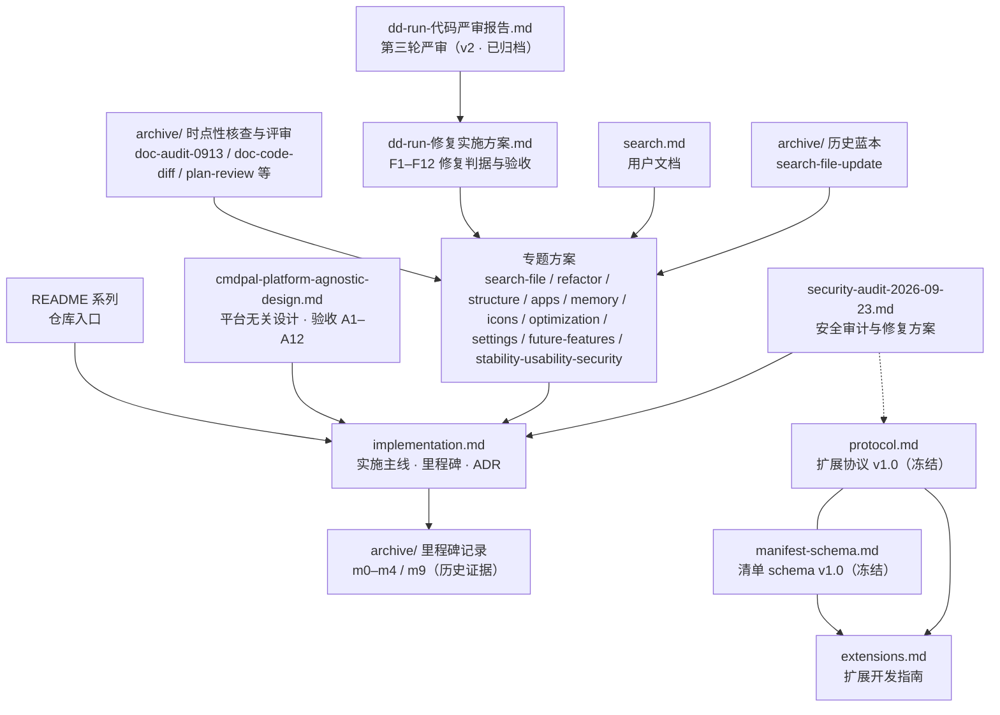

# dd-run 文档索引

> **状态**：生效中 ｜ **版本**：v1.41 ｜ **最后更新**：2026-10-21
> **用途**：全部文档的**唯一导航入口**——按模块分组、标注状态与读者，并定义文档格式规约。
> **关联**：（本文即导航入口——全部文档见 §3 清单并回链本文）

---

## 1. 怎么用这份索引

| 你的目的 | 阅读路径 |
|---|---|
| **写一个扩展** | [`extensions.md`](./extensions.md)（路径）→ [`protocol.md`](./protocol.md)（规范）→ [`manifest-schema.md`](./manifest-schema.md)（清单） |
| **了解项目现状** | [`README.zh-CN.md`](../README.zh-CN.md) → [`implementation.md`](./implementation.md) §里程碑状态总表 |
| **接手维护代码** | [`cmdpal-platform-agnostic-design.md`](../cmdpal-platform-agnostic-design.md)（抽象模型与验收 A1–A12）→ [`implementation.md`](./implementation.md)（ADR 与遗留台账）→ 各 [`mX-record.md`](./archive/m0-record.md)（过程与踩坑） |
| **排查文件搜索问题** | [`search.md`](./search.md)（用户视角）→ [`search-file.md`](./search-file.md)（权威技术口径）→ [`search-file-p2-acceptance-2026-09-15.md`](./search-file-p2-acceptance-2026-09-15.md)（真机验收结论） |
| **理解某个设计为什么这样做** | 先查 [`implementation.md`](./implementation.md) §4 ADR-1~ADR-4，再查设计文档对应章节 |
| **改协议 / 改清单格式** | [`protocol.md`](./protocol.md) §13（演进规则）→ [`manifest-schema.md`](./manifest-schema.md) §9，**两者均为冻结契约，改动须走版本协商** |
| **做安全加固 / 排查注入类缺陷** | [`security-audit-2026-09-23.md`](./security-audit-2026-09-23.md)（§1 结论总表 → §2.3 信任边界 → §3–§5 逐项修复 → §7 批次与验收） |

---

## 2. 文档地图



---

## 3. 全量文档清单

### A. 规范契约（冻结，硬契约）

改动须走版本协商；**不得为一处方便而破坏既有语义**。

| 文档 | 状态 | 版本 | 行数 | 读者 | 职责 |
|---|---|---|---|---|---|
| [`protocol.md`](./protocol.md) | 已冻结 | v1.0 | 788 | 宿主与扩展作者 | 进程间通信：JSON-RPC over NDJSON、生命周期、8 种执行结果、错误码、超时；**§7.4 含宿主对 `host/open_url` 的执行策略注（实现侧，非契约）** |
| [`manifest-schema.md`](./manifest-schema.md) | 已冻结（v1.0 清单字节不动；§9 分发签名为扫描层契约） | v1.0 | 175 | 扩展作者 | 扩展发现：清单字段、扫描目录、路径展开、9 条校验规则、内置注册、**§9 分发签名（O14）** |

### B. 设计与实施（主线）

| 文档 | 状态 | 版本 | 行数 | 读者 | 职责 |
|---|---|---|---|---|---|
| [`../cmdpal-platform-agnostic-design.md`](../cmdpal-platform-agnostic-design.md) | 生效中 | v1.0 | 547 | 设计者与维护者 | 平台无关抽象模型、页面/扩展/宿主模型、上下游对照、**验收项 A1–A12 的定义源** |
| [`implementation.md`](./implementation.md) | 生效中 | v0.1.20 | 1088 | 维护者 | 实施主线：里程碑状态总表、目标与范围、ADR-1~4、验收映射（含 §3.1 测试基线台账 627 + §3.1.1 内存基线台账 V-13）、遗留台账（L11 审计 11/11 销项）、实施沿革 |

### C. 开发指南与用户文档

| 文档 | 状态 | 版本 | 行数 | 读者 | 职责 |
|---|---|---|---|---|---|
| [`extensions.md`](./extensions.md) | 生效中 | v1.1 | 513 | 扩展作者 | 从零写一个扩展：快速上手、三条铁律、三个 Windows 陷阱、方法实现顺序、`host/*` 与**宿主信任门禁（§6.1）**、自检表 |
| [`search.md`](./search.md) | 生效中 | v1.3 | 123 | 最终用户 | 文件搜索的准备事项（**Everything 必需、`es.exe` 可选回落**）、**三种进入方式（含 `Ctrl+F`）**、动作、真实图标与回落说明、常见问题与排障 |

### D. 专题方案

实施记录与在途规划并存。已落地者保留作决策留痕，正文中的"计划时"表述已按实现校正；规划中者以状态列标注。

| 文档 | 状态 | 行数 | 职责 |
|---|---|---|---|
| [`search-file.md`](./search-file.md) | 生效中（v3.13） | 1088 | **文件搜索的权威技术口径**：双通道传输层、依赖与落地范围、两轮真机验收结论、图标分层异步与零依赖 PNG 编码器、`Ctrl+F` 直达、感知指标采样收口；逐版本沿革见文内 §8 |
| [`refactor-layering-plan.md`](./refactor-layering-plan.md) | 已落地 | 498 | `dd-gui` 业务代码 / UI 代码分层方案与切割表 |
| [`apps-filtering-plan.md`](./apps-filtering-plan.md) | 已落地 | 130 | Apps 扩展垃圾项过滤（黑/白名单、UWP 豁免、去重键） |
| [`memory-optimization-plan.md`](./memory-optimization-plan.md) | 已落地 | 129 | 运行时内存占用优化 M1–M4 与实测数据 |
| [`icons-typography-plan.md`](./icons-typography-plan.md) | 已落地（I3 未做；G1 已落地；真机复验 2026-10-07 完成） | 191 | 图标与字体展示优化：列表密度三档、占位 glyph、token 化；**G1 = 文件结果改用 Shell 真实图标（§4.5）** |
| [`optimization-plan.md`](./optimization-plan.md) | 规划中（O6 余真机腿 / O7 A-33-08 矩阵；v1.9） | 377 | **项目可优化方案总览（O1–O8）**：体积、协议健壮性、方法名常量、可观测性、依赖治理、跨平台，含已证伪项与落地记录；O6 三平台产物与发布链已于 2026-10-11 收口 |
| [`settings-personalization-plan.md`](./settings-personalization-plan.md) | 已落地（B1–B4 + T9/T11 落地，真机走查 2026-10-07 收口；T10 另行立项；v1.5） | 281 | **设置 / 个性化 / 材料样式方案（参照 PowerToys CmdPal）**：材料注册表化 + Mica Alt 档 + 着色三模式 + 行为项 + 重置外观 + T9 背景图通道 + T11 搜索 Steam 游戏开关；含 CmdPal 取证与差距分析 |
| [`settings-keys-typography-plan.md`](./settings-keys-typography-plan.md) | 已落地（**真机走查 V-1~V-7 收口——2026-10-07 用户批量确认**；v1.2 含落地勘误） | 243 | **设置页「按键与交互」排版与控件字号统一方案（D42，v4.19 入稿）**：设置行块 36→40 / 行距 12 / 名-描 +2 全设置页统一（K1）、控件排印 compact 档 28·12 常量组收口（K2，部分修订 D34 ③④）、下拉宽度自适应 `clamp(180, 260)` 纯函数（K3）；含三关验证、V-1~V-7 校验标准与 v1.1 三处勘误 |
| [`search-file-ctrl-f-icons-plan.md`](./search-file-ctrl-f-icons-plan.md) | 已落地（**E1 / E2 均已处置达标**；v1.3 增补 A-IC-08/09/10，v1.4 E2 关账） | 290 | **文件搜索开启方式与图标方案**：`Ctrl+F` 直达（决策 D1-x）与 Shell 真实文件图标（决策 D2-x）的决策留痕；§11 = 落地记录与 A-CF/A-IC 实测（首抽 703.8 ms **已由分层异步修复为 0.32 ms**；sidecar 体积已由 E2 处置达标 → `search-file.md` §10.6） |
| [`future-features-plan.md`](./future-features-plan.md) | 已落地（N1–N5 全部落地，真机走查 2026-10-07 批量确认；v1.9） | 220 | **v0.1.1 后功能向增量规划**：立项判据「可行 × 无冲突」+ 编号空间核查 + 五提案（N1 自定义直达 / N2 内置扩展配置通道 / N3 浏览器书签搜索 / N4 LRU 容量可配置 / N5 设置导入导出），均零协议与清单改动 |
| [`dd-run-修复实施方案.md`](./dd-run-修复实施方案.md) | 已落地（**F1–F11 全部闭环 2026-10-11**；F12 转 O14 承接并已发版） | 624 | **第三轮严审的修复设计与验收判据**：F1–F12 逐项给出影响面 / 冲突核查 / 批次顺序 / 可执行验收命令，附全局门禁与发布前检查单；F4 的 MSRV 声明值经实测修正为 1.95 |
| [`o9-o14-optimization-plan.md`](./o9-o14-optimization-plan.md) | 已落地（O9–O12 2026-10-11 / O13 2026-10-17 / O14 独立立项已发版；v1.6） | 182 | **第三轮严审后优化方向规划（O9–O14）**：O9 确认门覆盖嵌套 shell / O10 = F4 落地跟踪 / O11 CI 与仓库卫生 / O12 巨型文件拆分 / O13 文档一致性机检 / O14 扩展签名；含冲突面核查矩阵与逐项验收 |
| [`extension-signing-plan.md`](./extension-signing-plan.md) | 已落地（批次一 / 三 + 密钥仪式 + CI 自动签发 + v0.2.1 真包验签收口；v1.4） | 141 | **扩展签名立项与选型（O14 / F12 立项载体）**：ed25519 发行方公钥 + 清单旁挂 `.sig`（清单字节与 exe 双 SHA256 锚）+ 三态降级（通过免同意 / 失败 fail-closed / 无签名走同意流）；决策点 D1–D5 与三批次实施 |
| [`user-session-walkthrough-checklist.md`](./user-session-walkthrough-checklist.md) | 已落地（本机腿 2026-10-07 收口；余 R-21 / V-14 / O5-a 待特定环境） | 75 | **用户会话真机走查清单**：合成输入被本机安全软件过滤、物理键盘为唯一通路，集中承载无法自动化的腿（N1–N5 / T9 / 安全回归 / E2E 采样 / V-14 / O5-a tofu / T11），每腿含步骤、预期与记录位置 |
| [`stability-usability-security-plan.md`](./stability-usability-security-plan.md) | 已落地（R1–R26 代码与可做真机腿收口；余 V-7 / R-21 / V-14；v1.25） | 481 | **S 审计闭环后新一轮加固（R 系列 26 项）**：稳定 R1–R9 + R25/R26、安全 R10–R14、可用 R15–R24；含量化验收口径 V-1~V-16、零冻结契约改动、四批实施顺序与不做清单 |
| [`refactor-structure-2026-10-21.md`](./refactor-structure-2026-10-21.md) | 执行中（批次 A 已落地 + 真机冒烟通过；v1.3） | 309 | **代码结构整理方案（仅 dd-gui）**：实测体检（99 文件 / 45,251 非空行，dd-gui 占 58%）→ 问题清单 A 巨型单文件 / B 分层渗漏 / C 命名重叠 / D 别名 hack（lib 内 135 处 `dd_gui::` 自引用）→ 五批次纯搬运清单（`platform` / `aggregator` / `theme` 目录化 + 命名消歧 + 别名清理）与验收判据；§10 记批次 A 实测（627 passed、体积零漂移、行守恒）与自动化真机冒烟（含热键取值 / Job 连带杀进程 / DPI 虚拟化三个方法论坑）；`PaletteApp` 95 字段拆分、`state` 改名、跨 crate 分层搬迁均列不做项 |

> ⚠️ **V 编号空间提示**：`settings-keys-typography-plan.md` 的 V-1~V-7（其真机走查待做）与 `stability-usability-security-plan.md` 的 V-1~V-16（V-6/V-7 已完成或定性收口）是**两套独立编号空间**，同名编号互不指代，交叉阅读时以所属文档为准。

### E. 核查与评审报告

| 文档 | 状态 | 行数 | 职责 |
|---|---|---|---|
| [`doc-audit-2026-09-29.md`](./doc-audit-2026-09-29.md) | 生效中 | 89 | **全仓文档格式规约审计（INDEX §4）**：状态取值归一（2 处非法 + 里程碑 8 份历史格式）/ 元信息块补全（14 份）/ 规约外 emoji → 纯文字（12 文件 62 处，图例连动）/ INDEX 行数实测回填（17 行）/ 裸代码围栏补 text 标注（7 处）/ 链接 368 全可达；豁免与建议项（历史文档版本演进补建等）见其 §4 |
| [`search-file-plan-review.md`](./archive/search-file-plan-review.md) | 历史归档 | 149 | 文件搜索 v3.3 方案的编码前核对报告；每项结论已附**最终处置**（已解决 / 已规避 / 仍存在 / 已被取代） |
| [`dd-run-代码严审报告.md`](./dd-run-代码严审报告.md) | 历史归档 | 205 | **第三轮全仓严审（v2，基线 `b40ced9` / v0.2.0）**：安全与正确性逐条复核 + 新增 UI 排版、架构、运行速度、内存占用四维度；结论为「无现存高危漏洞」，P1–P4 与卫生项已由 F 系列 / O9 / O10 逐项销项，**权威口径在 [`implementation.md`](./implementation.md)** |
| [`search-file-p2-acceptance-2026-09-15.md`](./search-file-p2-acceptance-2026-09-15.md) | 生效中（v1.5） | 270 | **文件搜索 P2 真机验收报告（两轮）**：A-33-05/06/07/08/10 逐项实测（环境矩阵、耗时分解、1000 次基准、故障注入与通道级恢复判据），含未闭环项与复现命令；v1.1 依扩展内**分阶段计时日志**更正耗时分解，v1.2 记 **A-33-05 阈值修订决策**（§4.1.1），**v1.3 补 `es.exe` 基线与回落分支并把 A-33-05/06 改判通过**（§4.2.1 记录回落失败静默缺陷的修复），**v1.5 记 §5 #4 首屏感知指标采样收口（带词进页子集 p95 102 ms ≤ 200 PASS，含埋点两处修正）+ §5 #5 A-33-03 随用户批量走查收口**（开放项清零，余 A-33-08 环境矩阵红线） |
| [`security-audit-2026-09-23.md`](./security-audit-2026-09-23.md) | 生效中（v1.9，**S-12 扩展签名入账**） | 822 | **全量代码安全审计与修复方案 + 修复记录（11/11 闭环）**：79 个源文件（35,975 行）按攻击面分组走查，确认 11 项缺陷（**1 高 / 5 中 / 5 低**）+ **14 项已核验安全项**；**全部修复** —— S-01（命令注入，§3.1.1）、S-02（NDJSON 无界缓冲，§4.1.1）、S-03（`open_url` scheme 白名单，§4.2.1）、S-04（图标读盘+解码双上限，§4.3.1）、S-05（扩展信任门禁，§4.4.1–§4.4.3）、S-06（危险命令二次确认，§4.5.1）、S-07（剪贴板上限+溯源+toast，§5.2）、S-08（reveal 路径四条收紧，§5.3）、S-09（缓存名 FNV-1a 指纹，§5.4）、S-10（`entry.env` 关键变量保护，§5.1）、S-11（序列化 panic 面归零，§5.5）；含威胁模型与信任边界（§2.3）、逐项修复代码与验收判据、取证脚本（§8）、**「批量 spawn 用例失败（`error 231`）」的排查留档（§7.2，已定性为环境瞬时限制并复跑销项）** |

### F. 归档（`docs/archive/`）

**2026-09-29 起历史文档物理归档至 [`docs/archive/`](./archive/)**——里程碑记录（历史证据）与时点性核查 / 评审 / 旧蓝本不再平铺在 `docs/` 根目录，日常导航只看 A–E 节。归档文档**内容保持原样，刻意不做格式重排**（重写会破坏可追溯性），正文内的相对链接已按新位置修正。

**里程碑记录（历史证据）**

| 文档 | 行数 | 里程碑 | 关闭 |
|---|---|---|---|
| [`m0-record.md`](./archive/m0-record.md) | 145 | M0 地基与协议冻结 | 2026-09-01 |
| [`m0-verification-report.md`](./archive/m0-verification-report.md) | 110 | M0 验证报告 | 2026-09-01 |
| [`m1-record.md`](./archive/m1-record.md) | 169 | M1 最小可用面板 | 2026-09-02 |
| [`m2-record.md`](./archive/m2-record.md) | 292 | M2 命令执行与结果状态机 | 2026-09-02 |
| [`m2-verification-report.md`](./archive/m2-verification-report.md) | 96 | M2 验证报告 | 2026-09-02 |
| [`m3-record.md`](./archive/m3-record.md) | 154 | M3 缓存与懒加载 | 2026-09-02 |
| [`m4-record.md`](./archive/m4-record.md) | 339 | M4 内置扩展与健壮性 | 2026-09-04 |
| [`m9-inprocess-builtins.md`](./archive/m9-inprocess-builtins.md) | 146 | M9 内置扩展进程内化 | 2026-09-11 |

> M5–M8 的结论直接记于 [`implementation.md`](./implementation.md) §2，未单独建记录文件。

**时点性核查 / 评审 / 旧蓝本（内容仅代表撰写时点，权威口径在现行文档）**

| 文档 | 状态 | 行数 | 说明 |
|---|---|---|---|
| [`doc-audit-2026-09-13.md`](./archive/doc-audit-2026-09-13.md) | 历史归档 | 266 | 全量文档内容核对说明：所列错误、遗漏、矛盾均已处置（落实记录见 [`doc-code-diff-2026-09-13.md`](./archive/doc-code-diff-2026-09-13.md)） |
| [`doc-code-diff-2026-09-13.md`](./archive/doc-code-diff-2026-09-13.md) | 历史归档 | 350 | 文档 ↔ 代码差异清单与修复记录（71 条差异全部落实；代码侧闭环 9 项 + 两项协议口径定稿） |
| [`optimization-plan-review-2026-09-14.md`](./archive/optimization-plan-review-2026-09-14.md) | 历史归档 | 153 | `optimization-plan.md` 二轮核对报告：对应修订已落实（该方案已升至 v1.1+） |
| [`search-file-plan-review.md`](./archive/search-file-plan-review.md) | 历史归档 | 149 | 文件搜索 v3.3 方案的编码前核对报告；每项结论已附**最终处置**（已解决 / 已规避 / 仍存在 / 已被取代） |
| [`search-file-update.md`](./archive/search-file-update.md) | 历史归档 | 106 | 文件搜索 v2 升级设计的评审蓝本。权威口径见 [`search-file.md`](./search-file.md) |

### G. 仓库入口

| 文档 | 状态 | 行数 | 说明 |
|---|---|---|---|
| [`../README.md`](../README.md) | 生效中 | 116 | 英文 README |
| [`../README.zh-CN.md`](../README.zh-CN.md) | 生效中 | 116 | 中文 README（与英文版逐节对应） |
| [`../CHANGELOG.md`](../CHANGELOG.md) | 生效中 | 963 | 版本变更日志（`[0.1.0]`/`[0.1.1]`/`[0.2.0]` 条目均带日期；**`[0.2.0] - 2026-10-07` = 自 0.1.1 起累计变更的发版段**（含 7 条发布摘要与行为变更提示），其下按批分节——**O6 批次四打包链平台化（三平台发布产物）** / **O6 批次三非 Windows 运行时对齐（全局热键 + 单实例互斥）** / `Ctrl+F` 直达 + Shell 真实图标 / 零依赖 PNG 编码器（E2）/ 设置·个性化·材料（B1–B4）/ 安全审计 11 项闭环 / 设置页排版与控件字号统一（K1–K3，D42）/ **后续功能规划（N1–N5）** / **O5-a default_fonts 移除（-1.35 MiB）** / **A-IC-02b 空闲复测销项（图标验收 8/8 闭环）** / **T11 Steam 游戏搜索开关（默认不参与搜索）** / **自动化真机走查批次（R-08 / O4 / F2 复验 / 体积复核）** / **用户真机走查批量收口** / **§速度项真机采样收口**等） |

> 设计稿与交互演示（HTML）不在本索引收录范围内，已归档至 `docs/archive/`（O11，2026-10-11）：`archive/cmdpal-ui-mockups.html`、`archive/cmdpal-ui-optimization-v5.html`、`archive/cmdpal-window-material-effects.html`（窗口材质与边框方案效果页）。设计稿的**版本权威**在文件自身标题，最新决策见 [`implementation.md`](./implementation.md) §2 对应批次。

---

## 4. 文档格式规约

新增或修改文档时遵循以下约定，以维持全局一致。

### 4.1 元信息块（必需）

H1 之后**必须**紧跟此块（上下各留一个空行）：

```markdown
# 文档标题

> **状态**：生效中 ｜ **版本**：v1.0 ｜ **最后更新**：YYYY-MM-DD
> **关联**：[protocol.md](./protocol.md) · [manifest-schema.md](./manifest-schema.md)

---
```

**状态取值仅限五种**，含义如下：

| 取值 | 含义 |
|---|---|
| `生效中` | 描述当前实现，是最新口径 |
| `已冻结` | 契约类，改动须走版本协商 |
| `已落地` | 方案已实施完毕，保留作决策留痕 |
| `历史归档` | 内容仅代表撰写时点，**权威口径在别处** |
| `规划中` | 尚未实施 |

> 状态值后可加**括号限定**补充范围（如 `已落地（I3 未做）`、`生效中（v1.9，S-12 入账）`）——判定以括号前的五取值之一为准。
> **豁免**：`README.md` / `README.zh-CN.md` / `CHANGELOG.md` 遵循各自的外部通行格式（项目徽章结构 / Keep a Changelog），不套用元信息块。

### 4.2 结构与表达

| 项 | 规约 |
|---|---|
| 标题层级 | 一级 `## 1. 标题`、二级 `### 1.1 标题`，**连续编号** |
| 结论先行 | 文档开头（元信息块之后）先给结论/状态总表，历史沿革下沉到文末 |
| 事实唯一 | 同一事实**只在一处详述**，其余位置用链接引用，禁止重复叙述 |
| 追注处理 | **不得叠加追注**。新结论直接改写正文，旧结论收进文末"版本演进"表 |
| 代码块 | 一律标注语言（`json` / `rust` / `bash` / `toml` / `text` / `mermaid` / `python`） |
| 表格 | 统一 `\|---\|---\|`，表前给一句说明 |
| 任务 | 未完成 `- [ ]`、已完成 `- [x]` |
| 状态标记 | 只用 `✅` / `⚠️` / `❌` / `🟨`，**不使用装饰性 emoji** |
| 行号 | 写成「约 :NNN」，避免硬编码行号随代码漂移 |
| 行数 | §3 清单里的「行数」口径 = **换行符数**（`wc -l` 口径，含尾换行但不额外 +1）；新增文档后须实测回填，不得估算 |
| 表格内竖线 | 单元格内容里的 `\|`（正则交替、代码 span）**必须写成 `\|`**，否则 GFM 会把该行切错列 |
| 数字 | 版本号、字节数、测试数、测试阈值**必须实测取证**，不得沿用历史快照 |

### 4.3 新增文档流程

1. 判断归类——规范契约 / 设计实施 / 开发指南 / 专题方案 / 核查报告 / 里程碑记录 / 归档；
2. 套用 §4.1 元信息块与 §4.2 格式规约；
3. 在本文 §2 地图与 §3 清单中登记，并更新受影响的关联文档链接；
4. 若新增的是契约类文档，须同步 [`protocol.md`](./protocol.md) §13 与 [`implementation.md`](./implementation.md) 的验收映射。

---

## 5. 当前已知的未闭环项

### 5.1 开放项（需人工跟进）

| 项 | 位置 | 现状 |
|---|---|---|
| 文件搜索跨环境矩阵 A-33-08 | [`search-file-p2-acceptance-2026-09-15.md`](./search-file-p2-acceptance-2026-09-15.md) §5 | ⚠️ **唯一红线**：需在不同机器组合上复跑；其余 A-33 项均已通过 |
| 图标字体优化 I3（回退 32px） | [`icons-typography-plan.md`](./icons-typography-plan.md) | 保留不做：设计文档定为「视真机效果再定，不阻塞交付」——属**真机依赖项**，非文档卫生缺陷 |
| 平台真机验收腿 | [`optimization-plan.md`](./optimization-plan.md) §2.6.1 · [`user-session-walkthrough-checklist.md`](./user-session-walkthrough-checklist.md) | 产物已发布（v0.2.1 三平台）；余 **O6 ④**（热键实按 / Wayland 降级 / 双开提示）、**R-21**（需他机）、**V-14**（需多屏）、**V-7**（真实 IME 键盘）、**O5-a**（全页 tofu 走查） |

### 5.2 已闭环项（留索引，不重复叙述）

按 §4.2「事实唯一」，已销项条目只保留一行索引；明细见各文档正文与 [`implementation.md`](./implementation.md) §7 实施沿革。

| 项 | 闭环 | 权威位置 |
|---|---|---|
| 消息超上限「回 `-32600` + 关闭连接」两侧实现 | 2026-09-15 | [`protocol.md`](./protocol.md) §2.3（方案 O1） |
| 方法名无常量层（字符串字面量分发） | 2026-09-14 | `dd-protocol::methods`（方案 O2） |
| 文件搜索 P2 验收 A-33-05 / 06 / 07 / 10 | 2026-09-15 ~ 10-07 | [`search-file-p2-acceptance-2026-09-15.md`](./search-file-p2-acceptance-2026-09-15.md) §4 |
| `-32002 command_not_found` 已定义但无抛出点 | 2026-09-17 定稿 | [`protocol.md`](./protocol.md) §9.2 |
| `PageInfo` 已定义但运行时不传递 | 2026-09-17 定稿 | [`protocol.md`](./protocol.md) §8.5 |
| CHANGELOG `[0.1.0]` 缺日期 | 2026-09-15 | [`../CHANGELOG.md`](../CHANGELOG.md) |
| 全仓文档行尾 CRLF 归一（原 7 份偏离） | 2026-09-14 | 复检 bare-LF = 0 |
| `Ctrl+F` 直达 + Shell 真实图标（A-CF / A-IC） | 2026-09-19 · 10-07 | [`search-file.md`](./search-file.md) §10.4 |
| 文件搜索 `f ` 前缀直达（已被 `Ctrl+F` 取代） | 2026-09-19 | [`search-file.md`](./search-file.md) §6.1 |
| 代码安全审计 11 项（S-01–S-11） | 2026-09-24 | [`security-audit-2026-09-23.md`](./security-audit-2026-09-23.md) §7（台账 L11） |
